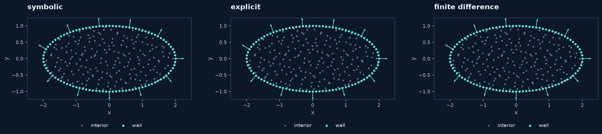

# Explicit parametric contours

`ParametricBoundary` defines one labeled curve arc. `ParametricDomain` connects arcs into one outer contour and zero or more hole contours. This API makes each contour's role explicit: the outer contour bounds material and each contour in `holes` bounds a void. Unlike the `Border` workflow, clockwise versus counterclockwise traversal does not decide whether a contour is a hole.

## One symbolic curve

```python
import sympy as sp
from rbflab import geometry as g, meshgen, viz

t = sp.symbols("t", real=True)
wall = g.ParametricBoundary(
    (2*sp.cos(t), sp.sin(t)), parameter=t, label="wall",
    interval=(0, 2*sp.pi),
)
domain = g.ParametricDomain(wall)
cloud = meshgen.generate(domain, interior=200, boundary=96, seed=42)
fig, ax = viz.plot_cloud(cloud, normals=True)
```



For symbolic curves RBFLAB differentiates the expressions. The parameter may be inferred if the curve has exactly one free symbol. Substitute other parameters first.

`ParametricBoundary` also accepts a callable and an optional `tangent=` or
`normal=` callback. `derivative_source` reports `symbolic`, `explicit`, or
`finite_difference`; see [labels and normals](labels-normals.md) before using
numerically differentiated normals in a flux condition.

## Assemble arcs and holes

```python
outer = [
    g.ParametricBoundary((3*t, 0), label="bottom", interval=(0,1)),
    g.ParametricBoundary((3, t), label="outlet", interval=(0,1)),
    g.ParametricBoundary((3*(1-t), 1+sp.sin(sp.pi*t)/4), label="top", interval=(0,1)),
    g.ParametricBoundary((0, 1-t), label="inlet", interval=(0,1)),
]
obstacle = g.ParametricBoundary(
    (1+sp.cos(t)/4, sp.Rational(1,2)+sp.sin(t)/4), label="obstacle")
second_hole = g.ParametricBoundary(
    (2.4+.15*sp.cos(t), .5+.15*sp.sin(t)), label="round_hole")
domain = g.ParametricDomain(outer, holes=[obstacle, second_hole])
cloud = meshgen.generate(domain, interior=350, boundary={
    "bottom":60, "outlet":24, "top":60, "inlet":24,
    "obstacle":40, "round_hole":32,
}, seed=42)
```


Arcs in each contour must connect end-to-start and close. Each arc excludes its final endpoint; the next arc owns the junction. Labels must be unique across the domain. Split at corners or wherever the boundary equation changes. Unlike directed borders, both clockwise and counterclockwise contours are accepted; tangent-derived normals are oriented outward from the material, including into holes. An explicit normal override is authoritative and must already have the intended direction.

For example, the four quarter-turn arcs of an ellipse can carry four boundary
equations while a separate hole carries a fifth:

```python
arcs = [
    g.ParametricBoundary((1.5*sp.cos(t), .9*sp.sin(t)),
        label=f"arc_{j}", interval=(j*sp.pi/2, (j+1)*sp.pi/2))
    for j in range(4)
]
inner = g.ParametricBoundary((.3*sp.cos(t), .3*sp.sin(t)), label="inner")
labeled_ellipse = g.ParametricDomain(arcs, holes=[inner])
labeled_cloud = meshgen.generate(labeled_ellipse, interior=220, boundary={
    "arc_0":30, "arc_1":30, "arc_2":30, "arc_3":30, "inner":36,
})
```

The four arcs start at successive quarter turns in local coordinates. Use any
increasing partition of the parameter interval when boundary conditions change
at other locations. If several arcs share one equation, keep their unique
`ParametricDomain` labels and assign that equation to each label later.

## Arc-length counts and geometric approximation

An integer `boundary=N` distributes a total approximately by arc length, with at least three nodes per arc. A dictionary specifies exact counts and must contain every label. Interior sampling is controlled separately by `interior`.

Membership for generic parametric contours uses a polygon with 2048 segments per arc, while boundary nodes lie on the curves. Increasing boundary counts does not refine this membership table. Thin gaps or demanding geometric tolerances may need a different geometry representation. Built-in disks, ellipses, annuli, and flowers use analytic membership; `with_holes` validates and combines via polygonal shapes.

For the available tangent/normal sources and their accuracy limits, continue to [labels and normals](labels-normals.md).
