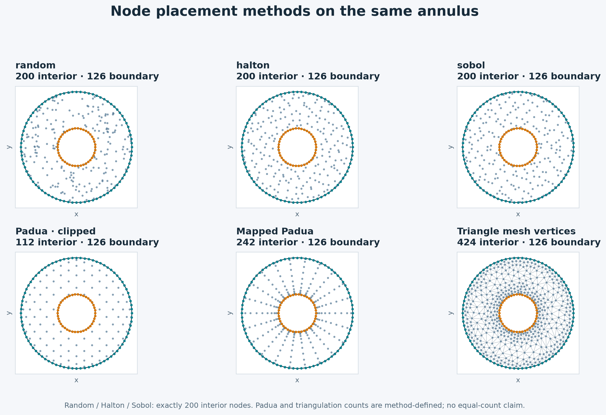
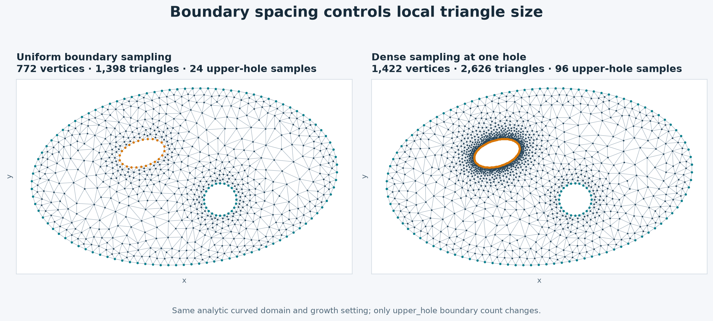
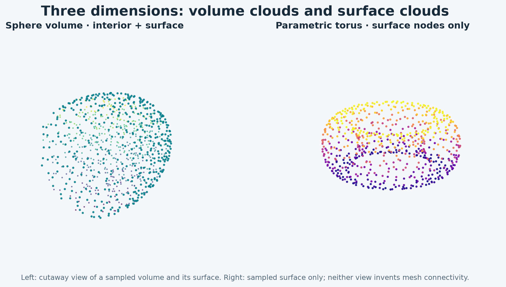
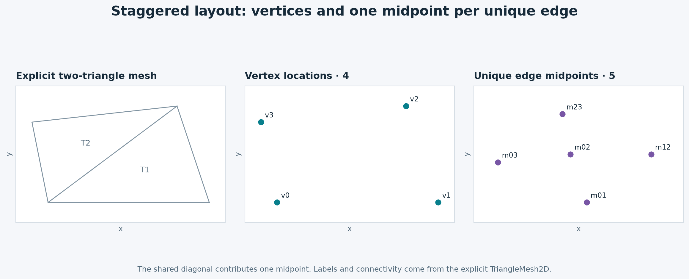

# Visual mesh atlas

Begin with a boundary, choose how many samples each part receives, then choose
whether the result needs only points or connected triangles. This is the same
construction order used in FreeFEM's border examples. RBFLAB keeps boundary
labels and normals available to the later RBF method.

The figures below are generated from the executable recipe
`examples/make_mesh_manual_gallery.py` in the source checkout.
Run `python -m examples.make_mesh_manual_gallery` from a source checkout with
`rbflab[examples,triangulation]` installed to regenerate them.

## Build the shape

Choose a [built-in shape](planar-domains.md) for a disk, ellipse, annulus,
flower, polygon or rectangle. [`with_holes`](planar-domains.md) combines a
material domain with named voids. For a custom outline, construct individual
[oriented `Border` pieces](parametric-borders.md) or a
[`ParametricDomain`](custom-domains.md) assembled from curves. The contour
defines the material; its samples define the discrete boundary.

## Assign boundary counts and labels

`wall(n)` fixes the number of samples on a `Border` piece. A negative count
reverses traversal, which can make an inner contour a hole. On a
`ParametricDomain`, `boundary={"inlet": 40, "wall": 80, ...}` assigns counts to
named arcs; these samples are spaced approximately by arc length. Labels name
groups for later boundary equations; they do not prescribe those equations.
See [labels and normals](labels-normals.md) for orientation at corners and
holes.

## Choose a node distribution

[`meshgen.generate`](sampling.md) produces a point cloud with Random, Halton,
Sobol or clipped Padua interiors. The separately sampled boundary retains its
labels and normals. [Mapped Padua](padua.md) forms radial patches around
supported star-shaped holes; its visible rays can be undesirable when an even
unstructured pattern matters. The figure shows how these recipes differ on
one domain. Degree and sizing settings yield different total point counts.

## Let the border drive interior refinement

[`meshgen.triangulate`](triangulation.md) makes a constrained triangle mesh.
Increasing the sample count on a hole shortens its boundary segments and asks
the mesher for smaller nearby triangles. `growth` controls how quickly target
spacing increases away from the boundary. The result includes vertices,
triangles and labeled boundary edges. For RBF methods, use
`geometry.staggered_clouds(mesh).vertices` to obtain a `PointCloud` with the
same triangle connectivity.

## Work in three dimensions

[Volumes](volumes-3d.md) include spheres, boxes, cylinders and custom implicit
regions. [Parametric surfaces](surfaces-3d.md) sample a two-parameter surface
and provide normals. These APIs produce three-dimensional point clouds;
they do not create tetrahedra. Surface labels and normals remain available
to your PDE boundary conditions.

## Use two sets of unknown locations

Once triangle connectivity exists, [`staggered_clouds`](staggered.md) creates
one cloud at vertices and a second at unique edge midpoints. Both inherit
boundary information from the connected mesh. Use this when a discretization
places different fields at different locations.

| Desired output | Recipe | Result |
|---|---|---|
| Unconnected 2D nodes in a labeled domain | [Generate](sampling.md) | `PointCloud` |
| Clipped or mapped Padua nodes | [Padua recipes](padua.md) | `PointCloud` |
| Boundary-refined connected triangles | [Triangulate](triangulation.md) | `TriangleMesh2D` |
| Imported Gmsh triangles | [Gmsh adapter](gmsh.md) | `TriangleMesh2D` |
| Vertex and edge-midpoint locations | [Staggered layout](staggered.md) | Two `PointCloud` objects |
| 3D volume or surface samples | [Volume](volumes-3d.md) / [surface](surfaces-3d.md) | 3D `PointCloud` |
