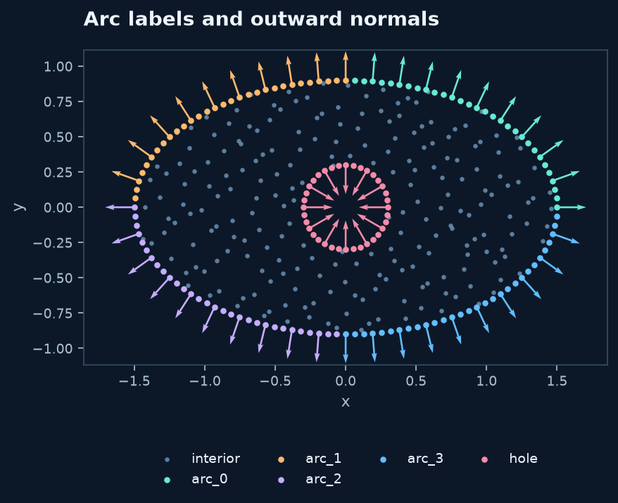

# Boundary labels and outward normals

A label identifies a boundary group; a normal identifies the direction out of the material at each group sample. Neither imposes a PDE equation by itself. Later, a model can assign a condition to a name such as `wall` or `inlet`.



## Split where the boundary role changes

```python
from rbflab import geometry as g, meshgen, viz

domain = g.with_holes(
    g.Ellipse(1.5, .9, labels=("arc_0", "arc_1", "arc_2", "arc_3")),
    {"hole": g.Disk(.3)},
)
cloud = meshgen.generate(domain, interior=220, boundary={
    "arc_0":30, "arc_1":30, "arc_2":30, "arc_3":30, "hole":36,
})
fig, ax = viz.plot_cloud(cloud, normals=True)
```

Each `cloud.boundary[label]` contains indices into `cloud.points`; `cloud.normals[label]` has matching rows. For a hole, outward-from-material points into the removed region.

## Why orientation depends on material

For a regular curve `gamma(t)=(x(t),y(t))`, a right-hand unit normal is

$$n_R(t)=\frac{(y'(t),-x'(t))}{\sqrt{x'(t)^2+y'(t)^2}}.$$

The material determines whether this or its negative is outward. Therefore the same circle has opposite outward directions as an exterior boundary and as a hole. `ParametricDomain` knows the contour role; in a `Border` collection, signed traversal helps classify positive outer contours and negative holes. See the [border workflow](parametric-borders.md).

## Choose a derivative source

Symbolic expressions are differentiated once. A callable may provide `tangent=...`; otherwise RBFLAB uses second-order finite differences with one-sided stencils near interval endpoints. The same choices are available to `Border` and `ParametricBoundary`.


For sensitive flux conditions, prefer symbolic or supplied derivatives. Numerical differentiation can lose accuracy for badly scaled parameters, noisy functions, corners, cusps, or vanishing tangents. `difference_step` is in parameter units and must be positive and no more than a quarter of the parameter interval. A finite normal is not an accuracy guarantee.

## Override normals explicitly

At curve level, `normal(t)` uses the curve parameter. At cloud level, a callback receives the boundary coordinates:

```python
import numpy as np
cloud = meshgen.generate(
    g.Annulus(.35, 1.), interior=200,
    boundary={"inner":40, "outer":80}, seed=42,
    normals={"inner": lambda p: -p / np.linalg.norm(p, axis=1)[:, None]},
)
```

Overrides are normalized and their direction is preserved; RBFLAB does not flip an explicit vector to make it outward. Cloud-level overrides take precedence over curve normals. Provide finite, nonzero vectors matching the boundary coordinate array shape.

## Junction ownership

For piecewise boundaries, the starting arc owns a shared junction. Its normal supplies the value at that point; there is no corner average and the other incident edge does not contribute a second node there. Treat corner equations deliberately, especially when the solution is not smooth.
