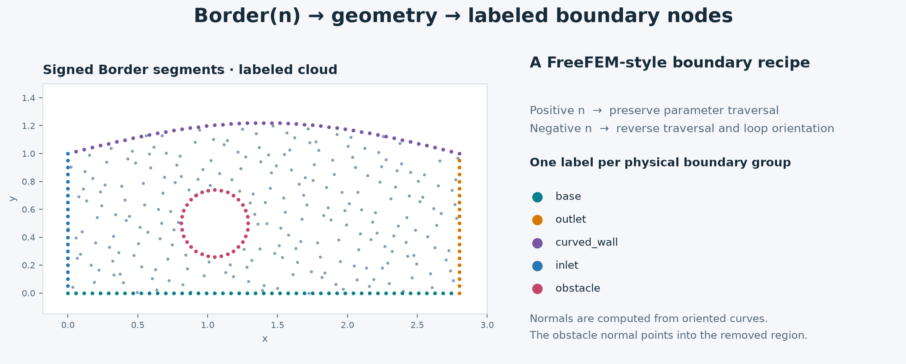
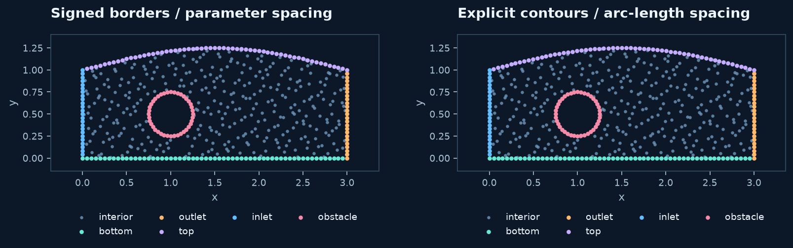

# Parametric borders: formulas, signed counts, and material

A `Border` is a labeled parameterized curve. As in FreeFEM++ border scripts, write the curve pieces in connected order, choose a signed segment count for each, and let directed contours describe material. `Border(n)` requests `abs(n)` segments; a negative count reverses traversal. Samples are uniform in the parameter, and the terminal endpoint is excluded so adjacent pieces do not duplicate their junction.



## Write a curve formula

```python
import sympy as sp
from rbflab import geometry as g, meshgen, viz

t = sp.symbols("t", real=True)
bottom = g.Border((3*t, 0), "bottom", 0, 1)
outlet = g.Border((3, t), "outlet", 0, 1)
top = g.Border((3*(1-t), 1+sp.sin(sp.pi*t)/4), "top", 0, 1)
inlet = g.Border((0, 1-t), "inlet", 0, 1)
obstacle = g.Border((1+sp.cos(t)/4, sp.Rational(1,2)+sp.sin(t)/4),
                    "obstacle", 0, 2*sp.pi)
```

Each formula returns `(x(t), y(t))`; the four channel pieces join end-to-start and close. Symbolic curves are differentiated automatically for tangent-derived normals. Extra symbols must be substituted with numeric values before building a border; only the curve parameter may remain free.

## Signed segment counts encode traversal

```python
borders = [bottom(60), outlet(24), top(60), inlet(24), obstacle(-40)]
cloud = meshgen.generate(borders, interior=350, seed=42)
fig, ax = viz.plot_cloud(cloud, normals=True)
```



The negative count on `obstacle` reverses its direction while still requesting 40 segments. The closed exterior runs counterclockwise, enclosing positive-area material; the obstacle runs clockwise, marking a hole. In this border workflow, contour orientation is significant: counterclockwise contours add material and clockwise contours subtract it. A hole must be inside an outer contour. Multiple disjoint holes can be described by additional clockwise contours. Overlapping positive contours are partitioned into regions; this is not unrestricted CAD Boolean composition.

The signed count changes traversal and orientation, not the physical shape. Keep pieces in directed connected order; RBFLAB does not silently reverse a mismatched piece. If endpoints fail to meet or a contour is not closed, correct formulas, order, signs, or tolerance. Avoid reusing the same mutable `Border` object for separate pieces.

## Generate from the sampled borders

Counts have already been applied to the border objects, so omit `boundary=`. The interior count is independent. `meshgen.generate` builds its own point cloud and does not mutate the supplied curves. Boundary labels become keys in `cloud.boundary`; labels may be shared to combine pieces with the same boundary role.

For ordinary NumPy callables, supply a tangent when known:

```python
import numpy as np
wall = g.Border(lambda t: (2*np.cos(t), np.sin(t)), "wall", 0, 2*np.pi,
                tangent=lambda t: (-2*np.sin(t), np.cos(t)))
```

Without `tangent=`, a callable uses second-order finite differences. An explicit `normal=` is also accepted and its direction is retained. See [labels and normals](labels-normals.md) before using numerical derivatives for flux conditions.

## Sampling versus geometric resolution

Border points are parameter-uniform, not generally arc-length-uniform. Their sampled segments define a polygonal membership approximation: raising `interior` does not refine the curves. Increase each piece's segment count to resolve curvature and narrow gaps. For approximately arc-length-uniform samples on analytic curves and a separate dense membership table, use [explicit parametric contours](custom-domains.md).

## Shared labels, interfaces, and an existing `RBFMesh`

Several exterior pieces may use the same label when they receive the same
boundary equation. For example, assign `"wall"` to both a top and bottom
piece; `cloud.boundary["wall"]` then groups their samples. A retained contour
inside the material can also define an internal interface. Such samples appear
in `cloud.interfaces` and remain interior unknowns; they receive no automatic
transmission equations or interface normals. Use distinct labels for exterior
boundaries and internal interfaces. An `is_border=False` piece can shape the
material without contributing labeled samples.

The object-list API remains available when a construction is stored as an
`RBFMesh`:

```python
mesh = meshgen.RBFMesh(*borders)
again = meshgen.generate(mesh, interior=350, seed=42)
print("stored samples:", len(mesh.Points), "cloud nodes:", len(again.points))
```

Generation rebuilds the sampled border geometry without changing the stored
`mesh.Points`. For connected triangles and boundary-driven interior refinement,
pass the same sampled borders to [triangulate](triangulation.md).
