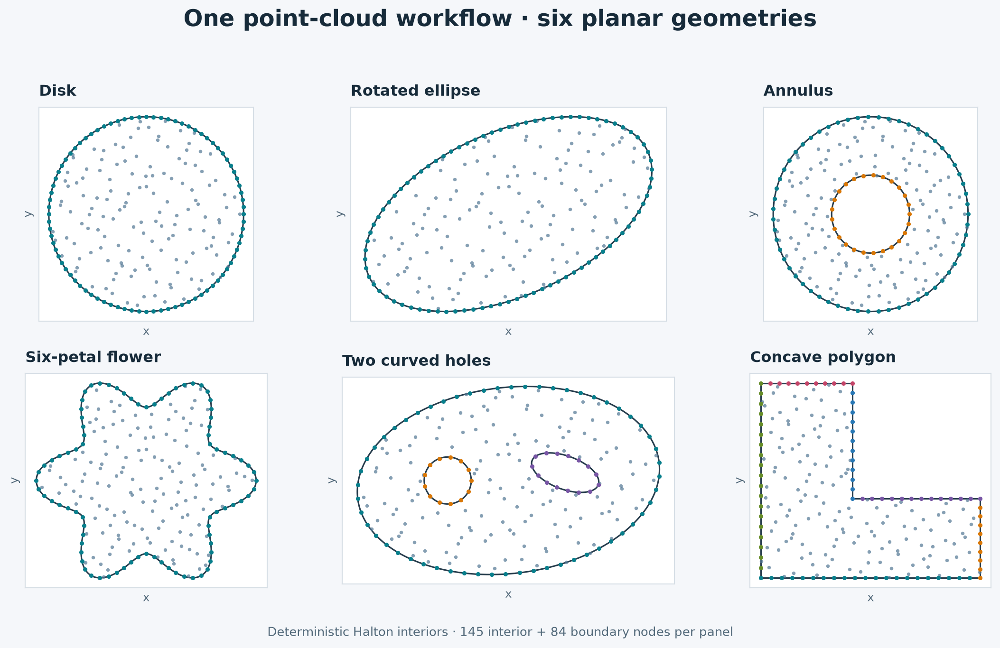
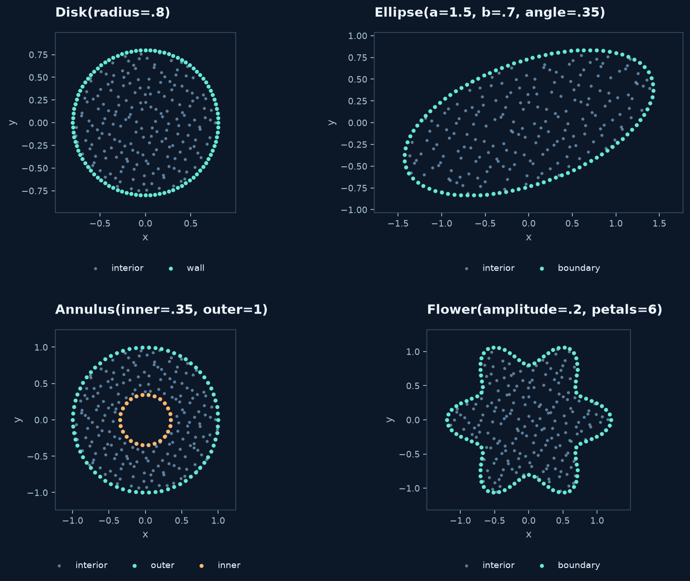
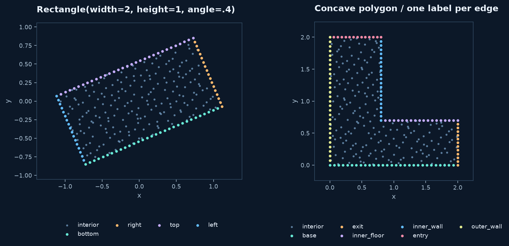
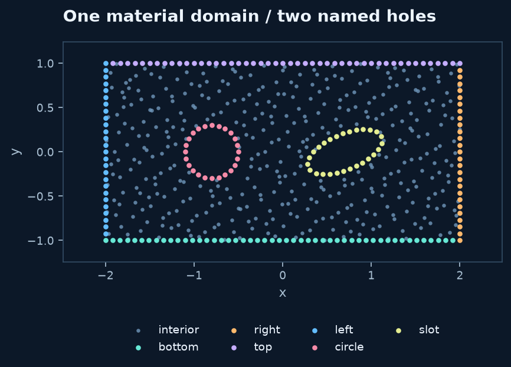

# Built-in planar domains

Use a built-in primitive when it already describes the filled material. The constructor defines the geometry and its boundary labels; `meshgen.generate` chooses the nodes. Lengths use your physical units and angles are radians.



## Smooth primitives

```python
from rbflab import geometry as g, meshgen, viz

disk = g.Disk(radius=.8, center=(0., 0.), label="wall")
ellipse = g.Ellipse(a=1.5, b=.7, angle=.35)
ring = g.Annulus(inner_radius=.35, outer_radius=1.)
flower = g.Flower(radius=1., amplitude=.2, petals=6)
cloud = meshgen.generate(ellipse, interior=200, boundary=96, seed=42)
fig, ax = viz.plot_cloud(cloud)
```



| Constructor | Filled material | Boundary labels |
|---|---|---|
| `Disk(radius=1, center=(0,0), label="boundary")` | Circle interior | One perimeter label |
| `Ellipse(a=1.3, b=.8, center=(0,0), angle=0, labels=("boundary",))` | Ellipse interior | One or more equal parameter-angle arcs |
| `Annulus(inner_radius=.4, outer_radius=1, center=(0,0))` | Between concentric circles | `inner`, `outer` |
| `Flower(radius=1, amplitude=.18, petals=5, center=(0,0), label="boundary")` | Radially modulated disk | One perimeter label |

Ellipse semi-axes are `a,b` (not full widths); its local curve is `(a cos(t), b sin(t))`, rotated counterclockwise about `center`. The flower has `r(t)=radius*(1+amplitude*cos(petals*t))`; require `0 <= amplitude < 1`. Larger modulation creates narrow features that need boundary and interior resolution.

## Straight edges and labels

```python
rectangle = g.Rectangle(width=2., height=1., angle=.4)
elbow = g.Polygon(
    [(0,0), (2,0), (2,.7), (.8,.7), (.8,2), (0,2)],
    labels=("base", "exit", "inner_floor", "inner_wall", "entry", "outer_wall"),
)
cloud = meshgen.generate(elbow, interior=200, boundary=120, seed=0)
```



A rectangle is centered at `center`; its default labels `bottom`, `right`, `top`, `left` refer to its local coordinates and rotate with it. `Polygon(vertices)` closes the final edge to the first, supports concave simple polygons, and names edge `j` from vertex `j` to vertex `j+1`. Vertices may be clockwise or counterclockwise. Self-intersections, repeated non-closing vertices, and zero-area polygons are invalid.

At a corner the starting edge owns the shared point and supplies its normal. There is no averaged corner normal. Split labels where the boundary equation changes.

## Add one or more holes

`with_holes(outer, mapping)` returns a new domain. Each mapping value is a simply connected shape to remove, and each key names that hole.

```python
plate = g.with_holes(
    g.Rectangle(4., 2.),
    {
        "circle": g.Disk(.3, center=(-.8, 0)),
        "slot": g.Ellipse(.45, .2, center=(.7, 0), angle=.4),
    },
)
cloud = meshgen.generate(plate, interior=400, boundary=200, seed=0)
fig, ax = viz.plot_cloud(cloud, normals=True)
```



Exterior labels are preserved. A single-arc hole gets its key (`circle`); a multi-edge hole gets labels such as `slot/edge_0`. Holes must lie strictly in the material and must not touch or overlap. Normals on every hole point from material into the opening. This is a hole-composition helper, not general Boolean CAD; curved membership is polygon-approximated for composed shapes.

For exact per-label counts, use the names in `domain.boundaries`:

```python
counts = {name: 40 for name in plate.boundaries}
cloud = meshgen.generate(plate, interior=400, boundary=counts, seed=0)
```

An integer total is allocated approximately by arc length, with at least three samples per arc. For custom curve formulas and contour construction, continue to [parametric borders](parametric-borders.md).
