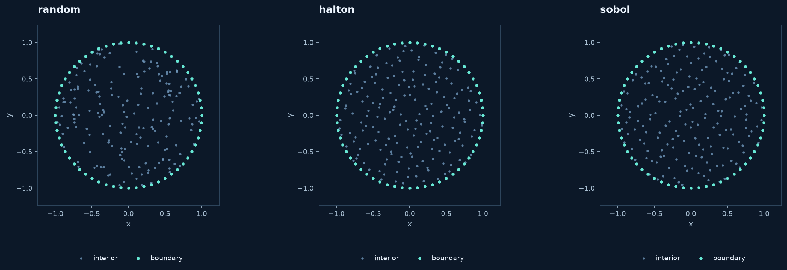

# Sampling, resolution and geometric quality

After fixing the geometry, choose how many samples to generate and how to
place them. Sampling choices affect spacing and the quality of local stencils;
they do not change the meaning of boundary labels.

## Step 1 — Choose a distribution

`meshgen.generate` returns a labeled `PointCloud`; it does not create mesh cells.
Choose a sampler based on the pattern you want, then inspect the actual nodes.

| Method | Dimensions | Resolution control | Result and limitation |
|---|---|---|---|
| `random` | 2D, 3D volumes, parametric surfaces | Requested count | Stochastic; no minimum-spacing constraint |
| `halton`, `sobol` | 2D and 3D volumes | Requested count | Low-discrepancy candidates; clipping/rejection changes their balance; no minimum spacing |
| `padua` | Planar geometry | Positive `degree` | Deterministic clipped reference grid; retained count varies with geometry |
| `mapped_padua` | Planar outer contour with separated holes | Degree per hole patch | Experimental radial map; requires strict star-shapedness and can cluster nodes |
| `triangulate` | One planar outer contour with disjoint holes | Boundary counts and sizing targets | Optional Triangle/MeshPy mesh; produces connectivity, not a fixed interior count |

The unified `generate(..., method=...)` entry point handles the first three
rows; `mapped_padua` and `triangulate` have separate functions because they have
different geometric constraints and outputs.

```python
from rbflab import geometry as g, meshgen, viz

domain = g.Disk()
cloud = meshgen.generate(domain, interior=180, boundary=60,
                         method="halton", seed=42)
fig, ax = viz.plot_cloud(cloud)
```



Compare the three count-based samplers on the same geometry:

```python
import matplotlib.pyplot as plt

for method in ("random", "halton", "sobol"):
    comparison = meshgen.generate(domain, interior=180, boundary=60,
                                  method=method, seed=42)
    fig, ax = viz.plot_cloud(comparison)
    ax.set_title(method)
    print(method, "interior:", len(comparison.interior))
```

In an interactive script, call `plt.show()` after the loop to display the figures.
Random nodes can show clumps and gaps; Halton and Sobol often cover the domain
more evenly, but check the actual cloud.
They keep the same domain and boundary count. Halton and Sobol are low-discrepancy
sequences; rejection at curved boundaries and truncation weaken their original
balance properties. **None of random, Halton, or Sobol enforces minimum spacing.**
For degree-controlled Padua distributions, see [Padua points](padua.md); for
connectivity and boundary-driven refinement, use [triangulation](triangulation.md).

A fixed seed reproduces a recipe without changing Python/NumPy global random
state through the unified generator. Use several independent seeds when assessing
a numerical method; one favorable cloud is not a stability result.

## Step 2 — Choose counts and understand the options

| `generate` option | Default | How to use it |
|---|---|---|
| `interior` | `400` | Exact material count for random/Halton/Sobol; omit for Padua |
| `boundary` | `100` | Total count, or a 2D dictionary with every arc label; omit for sampled borders |
| `method` | `"halton"` | Choose `"random"`, `"halton"`, `"sobol"`, or 2D `"padua"` |
| `seed` | `0` | Nonnegative integer for repeatable clouds; `None` for a fresh sample; Padua ignores it |
| `boundary_distance` | `0.` | Reject interior nodes too close to a boundary |
| `max_candidates` | `1000000` | Sampling budget; increase only after checking feasibility |
| `degree` | `None` | Required positive integer for Padua; invalid for other methods |
| `normals` | `None` | Label → arrays or callbacks; vectors are normalized, supplied direction retained |

### Counts mean different things on different inputs

| Geometry input | Interior resolution | Boundary resolution |
|---|---|---|
| Planar primitive or `ParametricDomain` | Exact requested `interior` count | Total `boundary`, or exact counts per arc label |
| `Border` or a list of borders | Requested material samples | Counts already assigned by `border(n)`; omit `boundary` |
| 3D volume | Exact requested `interior` count | Positive total surface count, distributed by the region sampler |
| Parametric surface | Must use `interior=0` | `boundary` is the surface sample count |

Internal-interface samples are retained in addition to the randomly/QMC-sampled
material points and count as interior unknowns. Boundary and interface metadata
are separate. Boundary pieces omitted with `is_border=False` are not sampled
into these groups, although they still define the border geometry.

## Step 3 — Control boundary clearance

`boundary_distance=.02` rejects interior samples closer than `.02` physical units
to the boundary. It does **not** enforce `.02` between every pair of interior nodes.
Generic planar clearance uses the polygon representation. A custom 3D implicit
region needs a suitable clearance function for physical-distance rejection.

`max_candidates` bounds the sampling search. If a thin domain or a large clearance
makes the request impossible within that budget, generation raises an error
rather than quietly returning fewer nodes.

## Step 4 — Inspect the cloud before a large solve

```python
print(meshgen.quality(cloud, stencil_size=25, polynomial_degree=2))
```

The report includes nearest-node spacing, a minimum/maximum spacing ratio,
local separation indicators and normalized polynomial-rank indicators.
Small ratios warn of close nodes or poorly shaped neighborhoods. These diagnostics
are geometric checks, not error bounds or guarantees of a stable PDE discretization.

## Keep four length scales separate

1. Physical **point spacing** between neighboring nodes.
2. **Stencil radius**, the extent of one local approximation.
3. Kernel **shape parameter**, whose units depend on the kernel convention.
4. Compact-kernel **support radius**, beyond which its value is zero.

Local coordinate scaling normalizes a stencil; it does not repair the input
cloud. See [conditioning and precision](../theory/conditioning.md).

## Refine geometry as well as nodes

Border samples define their polygonal geometry, so increasing `border(n)` refines
both boundary nodes and that approximation. Generic `ParametricDomain` uses a
separate fixed 2048-segment-per-arc table; increasing its boundary count does not
change the table. Built-in smooth primitives have analytic membership.

For a refinement study, increase interior and boundary resolution together,
resolve narrow gaps and curvature, test independent clouds, and measure geometry
error separately from PDE error when it can become significant.

## Padua interior points with existing boundaries

For a deterministic pattern controlled by polynomial degree, follow the
[clipped and mapped Padua lesson](padua.md). Clipped generation retains existing
boundary samplers and supports general planar geometry; the experimental mapped
route concentrates nodes around separated star-shaped holes.

## Boundary-driven triangulation

To refine the interior from boundary spacing and create actual triangle
connectivity, follow [the triangle-mesh lesson](triangulation.md).

## Step 5 — Run a small resolution experiment

```python
for count in (100, 400):
    refined = meshgen.generate(domain, interior=count, boundary=80,
                               method="halton", seed=42)
    fig, ax = viz.plot_cloud(refined)
    ax.set_title(f"{count} interior nodes; 80 boundary nodes")
    print(count, meshgen.quality(refined, stencil_size=25, polynomial_degree=2))
```

**Try it:** keep `interior=400` and compare `boundary=40` with `boundary=120`.
Only the boundary resolution changes. Next compare `boundary_distance=0.` and
`.05`; you should see an empty strip next to the disk wall, not evenly separated
interior nodes. An impossible clearance/count request raises an error.

Use [Padua nodes](padua.md) for a degree-controlled pattern or
[triangulation](triangulation.md) for boundary-driven local refinement.
