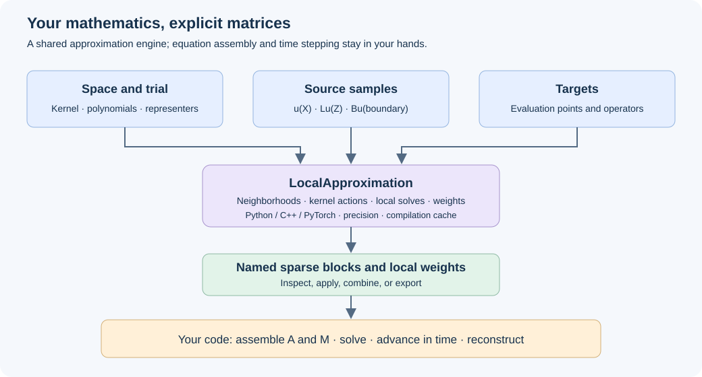
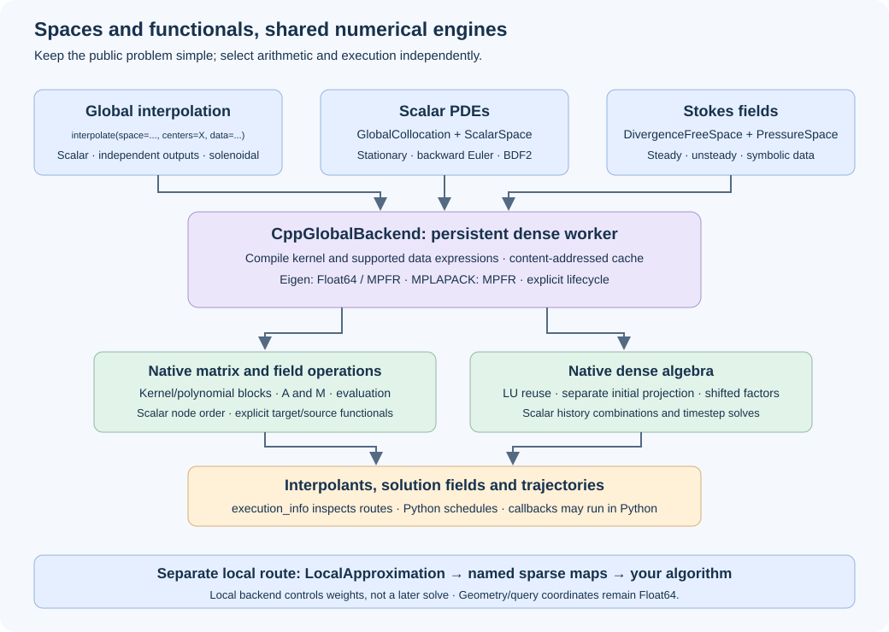

# Construct your method from approximation maps

A numerical method has several independent choices: the space, its trial
functions, the sampled data, the quantities to evaluate, and the equations that
use the resulting maps. `LocalApproximation` makes these choices visible.



## Start at the level you need

| Goal | Entry point | Result |
|---|---|---|
| Fit scattered values globally | `interpolate` | An interpolant with evaluation and derivatives |
| Construct local RBF-FD or Hermite maps | `LocalApproximation` | Named sparse blocks and local weights |
| Enforce global PDE collocation | `GlobalCollocation` | A coefficient-based system |
| Use existing packaged PDE assembly | `RBFFD` or `LHI` | A problem-specific system and solution |

The last row is retained for compatibility and specialized formulations. New
research examples use the common local construction. LHI remains a mathematical
method: its local PDE and boundary functionals are built into the approximation,
not added afterward to ordinary nodal RBF-FD weights.

### Which paths already share the engine?

Standard `RBFFD.operators` and `.weights` delegate to `LocalApproximation`.
Their compatibility adapter keeps SciPy matrices even for Torch local
construction. Direct `LocalApproximation` retains native matrix storage.
Scalar `LHI.assemble` also uses the shared weight engine, while its adapter
retains the earlier known-data assembly and solution reconstruction.

Stokes LHI with Python/C++ LU also delegates local weights to this engine;
its adapter retains the original stencil selection, compact equation assembly
and pressure-gradient reconstruction. Coupled scalar block assembly remains
separate, as do the explicitly selected Stokes SVD/experimental paths.
The common engine supports scalar spaces,
componentwise functionals on `DivergenceFreeSpace`, and matching Hermite
representers on a `MixedSpace` with explicit `FieldOperator` samples in 2D/3D.
Mixed maps do not automatically assemble a `SymbolicSystem`, impose pressure
closure, or select a time scheme. Vector samples are ordered node-major.

## Global interpolation and PDE execution

The global entry points share a persistent dense numerical engine:



Use `interpolate(space=space, centers=points, data=data, backend=CppGlobalBackend(...))` for scalar
or vector samples. Ordinary kernels and `ScalarSpace` fit independent columns
of an `(N, C)` array, sharing one native factorization. `DivergenceFreeSpace`
fits an `(N, dimension)` array with the coupled solenoidal kernel and polynomial
space; it does not silently replace ordinary vector interpolation.

`GlobalCollocation` accepts stationary scalar equations, scalar `EvolutionPDE`
problems, and supported `SymbolicStokes` problems. Scalar evolution retains
original cloud-node ordering, an indexed mass matrix, and a separate initial
coefficient projection. Python schedules backward Euler/BDF2 and exposes the
trajectory; C++ combines coefficient histories, applies mass, and solves the
shifted system. Stokes retains its existing Python history orchestration.
Supported symbolic data evaluate natively; arbitrary callbacks retain Python
execution. Selecting this global backend does not change the local-map route.

Native fits and systems own live workers. Close them or use a context manager.
This preserves the same space/data/operator separation without a second public
solver hierarchy. See [precision and backends](../api/precision-backends.md).

The canonical scalar PDE spelling is
`GlobalCollocation(space=ScalarSpace(kernel), collocation_scheme="symmetric")`.
An evolution system accepts `system.solve(dt=..., steps=..., time_scheme="bdf2")`.
The earlier positional kernel/space, `kernel=`, `scheme=` method keyword and
`scheme=` solve keyword remain compatible; supplying both aliases is an error.

Call `execution_info(fit)`, `execution_info(system)`, or
`execution_info(trajectory)` to inspect execution without evaluating the field,
exporting a matrix, or sending a worker request. Method and `LocalApproximation`
reports describe configuration; system and fit reports describe implementation.
Selected existing diagnostics appear in `recorded`. This metadata is not runtime
profiling. A local backend selects weight construction; the user's later global
solve has no implied backend. Geometry and query coordinates remain Float64.
Increasing arithmetic precision cannot recover digits lost in Float64 inputs.

## Five mathematical objects

| Object | Meaning |
|---|---|
| `ScalarSpace` or another supported space | Kernel, polynomial enrichment, field structure |
| `MixedSpace({name: space, ...})` | A direct sum of independently configured scalar/DF field spaces |
| `FieldOperator({field: operator_block, ...})` | Coupled linear functionals with explicit input/output components |
| `Samples(points, operator=..., size=...)` | What is sampled and how its local neighborhood is chosen |
| `Stencil(points, size=37)` | A shared geometric selection of physical sites for several sample groups |
| `space.representers(source)` | Trial functions made by applying source functionals to the kernel's second argument |
| `space.translates(points)` | Ordinary kernel translates, independently specified |
| `local.operators(targets=..., operators=...)` | Evaluate requested functionals of each local approximation |

For ordinary value samples, matching representers are ordinary translates. For
Hermite data they include the appropriate kernel derivatives. An explicit trial
can differ from the data functional construction. A differentiated trial alone
does not guarantee a symmetric matrix.

See the complete [operator tutorial](../tutorials/local-approximation.md), then
[LHI and heat from matrices](../tutorials/lhi-matrices.md).

## Named blocks keep the equation visible

Suppose an approximation gives

$$\tau u\approx W_uU+W_fF+W_bG.$$

`ops.tau["u"].matrix`, `ops.tau["pde"].matrix`, and
`ops.tau["boundary"].matrix` expose these three maps. Applying the operator to a
mapping of data sums the blocks. Their concatenation is available through
`ops.tau.matrix`; its columns follow source declaration order.

The maps do not permanently classify a sample as known or unknown. In a
stationary equation, $F=f$. In an evolution equation, $F=f-u_t$. That distinction
belongs to the user's equation and changes its mass/forcing contributions.

## Inspect and modify

`.local(i)` exposes local weights and membership. `.reconstruct_local(i)` rebuilds
the local augmented matrix and target right-hand side on demand. The dense
systems are not stored for every target. `.weights(target=..., operator=...)`
provides the corresponding single-target construction from the configured source
groups.

For the square augmented system $H$, weights solve

$$H^T\begin{bmatrix}w\\\eta\end{bmatrix}=q_\tau.$$

The polynomial multipliers $\eta$ are local algebra, not extra global unknowns.
See [the derivation](../theory/local-weights.md). Neither successful factorization
nor a small local residual proves global stability.

## Numerical execution

Select neighborhood/scaling policy, arithmetic, and local factorization
independently of the differential equation. Python, C++, and Torch execute the
supported local construction; selecting one does not move your SciPy global
solve or time loop onto that backend.

- Python provides the reference numerical path and supported extended arithmetic.
- C++ provides native local construction with Float64 or MPFR; its optional source
  toolchain is described in [installation](../INSTALL.md).
- Torch provides supported tensor-based local construction; current documented
  examples use CPU Float64. This interface does not imply a GPU-resident or
  end-to-end differentiable PDE solve.

Only advertise a backend/space combination after checking
[capabilities](../CAPABILITIES.md). `Precision(local_digits=50)` alone does not
request extended precision for a separate SciPy solve. Full extended sparse
storage uses the supported `global_dtype="mpmath"` path; convert neither matrix
nor data to Float64 if preserving that arithmetic matters.

`LocalApproximation` exposes `kernel_scaling="physical"` by default;
choose `kernel_scaling="local"` to normalize kernel coordinates. `None` is an
alias for `"physical"`. `StencilPolicy` remains accepted for compatibility;
its `scaling` participates in the same policy, and explicitly conflicting
`kernel_scaling` and `stencil_policy.scaling` values are rejected. This is
separate from algebraic equilibration in a local solver. Shape-sensitive kernels
change meaning under coordinate normalization. See
[conditioning](../theory/conditioning.md).
The radius convention is route-specific to preserve existing methods:
single-field `LocalApproximation` measures the maximum distance over selected
source **and trial** centers from the first selected source center. Mixed
`LocalApproximation` and Stokes LHI use matching source/trial sites and measure
their radius from the target. The zero-radius fallback is one. Physical derivative
chain factors are already included in returned weights; do not apply them again.

## Select exact or geometric source neighborhoods

`Samples.size` selects nearby points independently for each source group.
`target="allow"`, `"exclude"`, or `"require"` controls coincident-point membership.
To reproduce a specific paper stencil, supply `indices=memberships`,
one row of group-local integer indices per target, instead
of a size/selection policy.
Normal-dependent boundary samples accept `normals=...`; geometry can supply
these through its labeled boundary data. A per-group `policy` controls selection;
coordinate scaling belongs to the whole `LocalApproximation` through
`kernel_scaling`.

## Mixed field Hermite maps

Start with `python -m examples.mixed_local_maps` for a short example that
recovers two scalar fields from their sum and contrast. Each numbered step
introduces one public object. For a 37-point divergence-free Stokes stencil,
run `python -m examples.stokes_lhi_weights`; it constructs momentum and
pressure-gradient maps without assembling a global PDE.

??? example "One mixed Stokes stencil"

    ```python
    --8<-- "examples/stokes_lhi_weights.py"
    ```

Declare linear functionals as rectangular blocks of existing differential
operators. Each block has shape `(output_components, field_components)` and
all blocks share an output row count. Omitted fields contribute zero; literal
`0` is the only numeric shortcut. No fluid role is attached to field names.

```python
I, Dx, Dy, Lap = Identity(), Derivative(0), Derivative(1), Laplacian()
space = MixedSpace({
    "u": DivergenceFreeSpace(Ku, polynomial_degree=6),
    "p": ScalarSpace(Kp, polynomial_degree=1),
})
U = FieldOperator({"u": [[I, 0], [0, I]]})
P = FieldOperator({"p": [[I]]})
L = FieldOperator({
    "u": [[-nu*Lap, 0], [0, -nu*Lap]],
    "p": [[Dx], [Dy]],
})
source = {
    "velocity": Samples(Xu, operator=U, indices=velocity_rows),
    "momentum": Samples(Xl, operator=L, indices=momentum_rows,
                        target="exclude"),
    "pressure": Samples(Xp, operator=P, indices=pressure_rows),
}
local = LocalApproximation(source=source, trial=space.representers(source))
maps = local.operators(targets=owners, operators={"momentum": L, "pressure": P})
```

The arrays and kernels in this construction are supplied by the application.
For a 37-physical-site experiment, select those sites once, then derive each
group's exact membership rows; `size=37` separately on each group would select
different observation sets. The pressure group has one column per global
pressure site, shared by every local stencil selecting it.

`maps.momentum["pressure"].matrix` has two rows per target and one column per
pressure point. `maps.pressure["velocity"].matrix` has one row per target and
two columns per velocity point. Applying a mixed map returns
`(number_of_targets, output_components)`, including an `(N, 1)` array for scalar
outputs, independent of how individual source arrays are shaped. MP storage
returns the analogous mpmath matrix. `.matrix` remains the flat linear map.

Mixed interpolation uses direct-sum degree-generated polynomial spaces with
target-centered, maximum-Euclidean-radius normalized coordinates. Kernel
coordinates remain physical by default; `scaling="local"` uses that same
target-centered radius for the kernel, in Python, C++ and MPI execution.
All source functionals must be explicit `FieldOperator` objects; implicit
identity and bare scalar operators are ambiguous on a mixed space and rejected.
Zero/repeated targets are allowed; zero/duplicate local source rows are rejected.
Matching mixed representers are supported; mixed translates and arbitrary mixed
source/trial pairing are not. A `PressureSpace` mixed factor omits constant
polynomials and accepts only functionals annihilating its additive constant.
Use `ScalarSpace` for pressure values and choose the gauge in global equations.
In 2D, solenoidal polynomial columns use the canonical streamfunction-curl
basis; 3D retains the exact divergence-nullspace basis.

For mixed requests, `selection="quality"` checks the actual combined functional
polynomial matrix, including all fields and derivative observations. It grows
each eligible sized group by one neighbor per round until the joint rank and
ratio threshold and each quality group's node-separation threshold pass, or
the configured limits are exhausted. The strictest participating polynomial
ratio is used. Separation checks use distinct physical sites, so different
Hermite observations can share a point. Explicit `indices`, groups with
`size=None`, and groups overriding the policy with `selection="nearest"` stay
fixed. These checks improve stencil selection; they do not certify the full
kernel matrix's conditioning or the stability of an assembled PDE.

Python supports Float64 and extended local arithmetic. C++ performs the field
kernel contractions and local LU natively, in Float64 or MPFR. Select it through
`backend=CppBackend(threads=1)` and, for example,
`precision=Precision(local_digits=80, global_dtype="float64")`. This does not
upgrade Float64 geometry or a separate global solve. Mixed Torch execution is
not supported.

For actual MPI scheduling of native mixed weights, add
`execution=LocalExecution(scheduler="mpi", ranks=2)` to `LocalApproximation`.
MPI requires `CppBackend` and a working MPI launcher. `launcher=("mpiexec",
"--oversubscribe")` supplies an explicit prefix. Windows can use native MPI or
the WSL bridge (`wsl_distribution="Ubuntu"`); when no native launcher exists,
the default Windows bridge uses Ubuntu. Each rank launches the same packaged
native worker on assigned jobs; rank completion records and result ordering
are validated. MPI does not distribute equation assembly or the global solve.
`reuse="exact"` reuses identical serialized jobs; it does not merge approximately
equal or translated geometries. Other local approximation paths reject an
explicit `LocalExecution` rather than silently ignoring it.

### Existing Stokes LHI through the common engine

Source version **0.6.0** routes existing Python/C++ LU Stokes LHI weights through
`LocalApproximation`. Its stencil/data adapter supplies velocity values and
neighboring momentum observations, excluding owner momentum. It introduces no
pressure-value samples or global pressure unknowns. The same quotient pressure
tail and normalized 2D polynomial columns are used, with the same compact
`M = I - SL`, `SY`, `SB`, and local pressure-gradient maps.

The public equation declaration remains unchanged. To distribute native LU
weights, add scheduling on the existing method:

```python
method = LHI(
    spaces=spaces,
    stencil_size=37,
    local_backend=CppBackend(threads=1),
    precision=Precision(local_digits=80, global_dtype="float64"),
    execution=LocalExecution(scheduler="mpi", ranks=2),
)
system = method.assemble(problem, cloud)
report = execution_info(system)
```

The cloud must support the selected stencil and polynomial rank. Shape-policy
parameters are bound before constructing common local requests; compatible
effective kernels are batched together. Python process workers remain supported
and call the common API per task. Global sparse assembly, solves and time
stepping stay in Python. Stored equation matrices retain their historical
component-major velocity ordering; generic local maps retain their documented
node-major convention through the adapter's explicit row mappings.

With fixed kernel parameters, Stokes `LHI` accepts
`stencil_policy=StencilPolicy(scaling="local")` in both Python and the standard
C++ LU path, including MPI scheduling. Direct `LocalApproximation` exposes the
same coordinate scaling as `kernel_scaling="local"`. This preserves
Stokes' target-centered radius and physical derivative chain factors. It is
distinct from supplying full mesh-dependent
kernel parameters in physical coordinates: switching the policy while retaining
the same numeric kernel parameters changes the kernel. Keep `scaling="physical"`
when reproducing an experiment that already incorporates its full scaling in
the kernel parameters and amplitudes.

`system.recipe["backend_diagnostics"]` and `execution_info(system)` identify
`local_weight_engine="LocalApproximation"` and actual local execution batches.
Pressure output remains local gradients, and nearest-patch velocity remains
patchwise analytically solenoidal. This consolidation does not establish global
divergence conformity or change the method's stability.

Explicit `LocalSolver("svd")`, historical custom executables and experimental
backends retain specialized implementations; they do not silently substitute
the common LU solver. Explicit scheduling is rejected on those paths. Standard
scalar LHI scheduling remains outside this method-level extension.
The native SVD and explicit historical-executable routes still require physical
kernel coordinates. The `hardy`, `radius_scaled` and `separation_scaled` shape
rules also require physical coordinates; combining them with local coordinate
scaling is rejected.

### Generic examples and quotient observations

Run the complete generic example with
`python examples/mixed_local_maps.py`; add `--backend cpp --digits 50` or
`--backend cpp --mpi 2` for native execution. It uses coupled observations of
two scalar fields, demonstrating the same generic construction without a fluid
solver. Operator diagnostics include actual local execution metadata.

For the single-field quotient `PressureSpace`, all sampled/trial/target
functionals must annihilate constants. It omits the constant polynomial and
does not force degree zero when degree is `None`. Absolute nodal pressure
observations belong to `ScalarSpace`. Applications relying on the earlier
implicit constant in direct `LocalApproximation`/`RBFFD.operators` should migrate
those absolute observations explicitly; specialized Stokes paths are unchanged.

## Compilation and reuse

Kernel derivative preparation and compilation can be cached across compatible
requests. A compiled expression can be reused when parameters change; numerical
factorizations generally cannot. Do not treat compilation caching as a promise
that stencil matrices or weights remain valid after changing geometry or kernels.

## Evolution is a matrix algorithm

Construct $M$, $A$, and $b(t)$, then write the integrator:

$$M\dot U+AU=b(t).$$

Backward Euler solves $(M/\Delta t+A)U^{n+1}=MU^n/\Delta t+b(t_{n+1})$.
BDF2 or a projection method uses the same spatial maps. No library evolution
object is required. Boundary elimination and constraints remain visible in the
matrix construction. Do not assume that a constrained mass matrix is invertible.

Existing symbolic evolution conveniences remain available; see
[the heat comparison](../tutorials/heat-equation.md). Global collocation still
uses expansion coefficients, while local maps act on named sampled data. Keeping
those interpretations explicit is more important than giving every method the
same solver wrapper.
# Explicit patch interpolation

`PatchCover(centers, radii)` defines fixed overlapping ball supports in 2D or
3D. Pass it as `patches=cover` to `interpolate` for scalar or independent
multioutput data. Every input and query point needs positive support; an
uncovered point raises `ValueError`. Local factors are retained by the fit and
`fit.refit(new_data)` updates values on the same geometry without rebuilding
them. Both Python and `CppGlobalBackend` support Float64 and
`Precision(global_digits=...)`.

```python
cover = rbflab.PatchCover(centers=[[-0.5, 0], [0.5, 0]], radii=[1.7, 1.7])
fit = rbflab.interpolate(space=rbflab.ScalarSpace(rbflab.Gaussian(1)),
                         centers=X, data=Y, patches=cover)
values = fit.evaluate(Q)
gradient_x = fit.evaluate(Q, rbflab.Derivative(0))
```

The compact C2 patch weights are normalized and differentiated through order
two, including the product rule for overlap derivatives. Scalar outputs support
derivatives through order two. The explicit cover scans patches during query
routing, so evaluation has an `O(PQ)` geometry component for P patches and Q
points. See `examples/pum_interpolation.py`.

For planar divergence-free data, pass a `DivergenceFreeSpace` and a 2D cover.
Each patch fits the coupled vector kernel. RBFLAB recovers its local scalar
streamfunction, aligns additive constants at patch overlaps using weighted
least squares, then takes the curl of the blended streamfunction. The field is
analytically divergence-free on the positive cover. It is an **approximant**:
the weight-gradient correction generally changes nodal values. Inspect
`fit.evaluate(X) - Y` if nodal discrepancy matters. `fit.potential(Q)` returns
the blended streamfunction, and `fit.divergence(Q)` computes divergence from
the two component derivatives. `evaluate_mp`, `potential_mp`, and
`divergence(Q, extended=True)` retain mpmath precision. `refit` reuses local
factors and the overlap graph factorization. The C2 cover supports velocity
and first derivatives; higher derivatives raise `NotImplementedError`.
With `CppGlobalBackend`, local coupled solves and blended potential/velocity
evaluation run in one retained native worker; overlap alignment and sample
preparation run in Python at the requested mpmath precision. The overlap
graph factorization is dense here, so arbitrary patch counts have no
near-linear scaling guarantee.

```python
space = rbflab.DivergenceFreeSpace(rbflab.IMQ(), polynomial_degree=1)
fit = rbflab.interpolate(space, X, velocity, patches=cover)
velocity_at_q = fit.evaluate(Q)
streamfunction_at_q = fit.potential(Q)
divergence_at_q = fit.divergence(Q)
```

This implementation covers planar 2D fields. Surface fields, 3D divergence-free
fields, PDE solves, and pressure gauges are outside this interpolation API.
The fitted potential assumes a globally single-valued streamfunction on each
connected cover component. On a multiply connected domain with nonzero flux
around a hole, that assumption can fail. A runnable triangulated disk example
is in `examples/dfpu_interpolation.py`.
The construction follows [Drake, Fuselier and Wright (2021)](https://arxiv.org/abs/2010.15898),
equations 19–24. Disconnected patch groups receive separate zero gauges; the
streamfunction is therefore comparable only within each group. Coincident
patch centers make the paper's distance weight ratio undefined; this
implementation uses uniform glue weights in that case. Extremely
unbalanced overlap weights can make Float64 potential alignment lose numerical
rank; choose a more balanced cover or `Precision(global_digits=...)`.

### Build patch covers automatically

`PatchCover.from_points` builds reproducible ball supports from distinct 2D or
3D samples. It uses seeded farthest-first initialization followed by Lloyd
iterations. `points_per_patch` sets the clustering target before radii are
expanded; it is not a maximum membership count. Every input point lies strictly
inside at least one support, and `min_points` sets a minimum support occupancy.
That count does not certify polynomial rank. Point samples alone cannot certify
coverage of the space between them.

```python
cover = rbflab.PatchCover.from_points(
    X, points_per_patch=32, overlap=0.25, min_points=6, seed=0
)
fit = rbflab.interpolate(rbflab.Gaussian(1), X, Y, patches=cover)
```

For a `TriangleMesh2D`, `from_mesh` places at least one patch in each connected
mesh component. Each mesh triangle has all three vertices strictly inside one
ball. Because balls are convex, its edges and interior are covered as well.

```python
from rbflab.geometry import TriangleMesh2D

mesh = TriangleMesh2D(vertices, triangles)
cover = rbflab.PatchCover.from_mesh(mesh, points_per_patch=32, seed=0)
fit = rbflab.interpolate(rbflab.Gaussian(1), mesh.vertices, Y, patches=cover)
```

The supports are balls in ambient space. Their boundaries are not clipped to
the mesh boundary or holes; restrict queries to your physical domain when that
matters. For either constructor, `n_patches` sets an exact count if supplied.
## Shared physical stencils

To split observations over different node sets without changing the physical
stencil, share a geometric selection object:

```python
stencil = r.Stencil(points, size=37)
source = {
    "velocity": r.Samples(interior_points, operator=u, within=stencil),
    "boundary": r.Samples(boundary_points, operator=u, within=stencil),
    "momentum": r.Samples(interior_points, operator=momentum,
                          within=stencil, target="exclude"),
}
```

`Stencil` introduces no observations or unknowns (`SharedStencil` is its
compatibility alias). It selects 37 nearest
physical sites with the existing nearest-neighbor convention. Each sample
group intersects those sites with its own points by exact coordinate equality,
then applies target filtering without refilling. The fixed shared selection
does not grow under a quality policy. It works with scalar and mixed spaces
before dispatch to Python, C++ or MPI. Named-group `within="velocity"` remains
available when another observation group already defines the shared sites.

The complete `examples/stokes_local_approximation.py` demonstrates separate
boundary blocks and a nonzero time-dependent prescribed velocity:
`M U_t + A U = M f - B g(t)` and
`grad(p) = PY U + PB g(t) + PL (f - U_t)`. There is no manual component-column
selection. MPI constructs the local weights; SciPy advances the global system.

Field expressions can replace explicit component blocks:

```python
u, p = space.fields
velocity = u
momentum = -nu * r.laplacian(u) + r.gradient(p)
pressure_gradient = r.gradient(p)
```

These linear expressions compile to `FieldOperator` on the sample geometry.
The explicit block API remains available. See the complete readable example
in `examples/stokes_local_approximation.py`.

For componentwise operators, index a vector expression and stack scalar
outputs. For example, the same momentum can be written as:

```python
momentum = r.vector(
    -nu * r.laplacian(u[0]) + r.dx(p),
    -nu * r.laplacian(u[1]) + r.dy(p),
)
```

`r.derivative(expr, axis=0, order=2)` applies a second derivative; nest calls
for mixed derivatives. `dx`, `dy` and `dz` are coordinate shortcuts. Derivatives
act componentwise on vector expressions. `vector` accepts scalar expressions
and can have any positive number of output rows, independent of dimension.
Indices are nonnegative; axis/index bounds and output-size compatibility are
checked when geometry supplies the dimension. See
`examples/component_operators.py` for a complete scalar-field example comparing
the expression and explicit block syntax, including MPI weights.

Use `Samples(..., within="group_name")` to restrict a sample group to physical
sites selected by another source group:

```python
source = {
    "velocity": r.Samples(points, operator=velocity, size=37),
    "momentum": r.Samples(interior_points, operator=momentum,
                          within="velocity", target="exclude"),
}
```

This selects 37 velocity sites, intersects them with the momentum group's
points by exact coordinate equality, and excludes the target. It does not
refill missing or excluded sites. `within` cannot be combined with `size`,
`indices`, or a group `policy`. References may appear in either order; missing
references and cycles are rejected. When a mixed quality-controlled parent
stencil grows, its dependent groups are refreshed before testing joint rank.
Selection happens before Python/C++/MPI weight construction.
