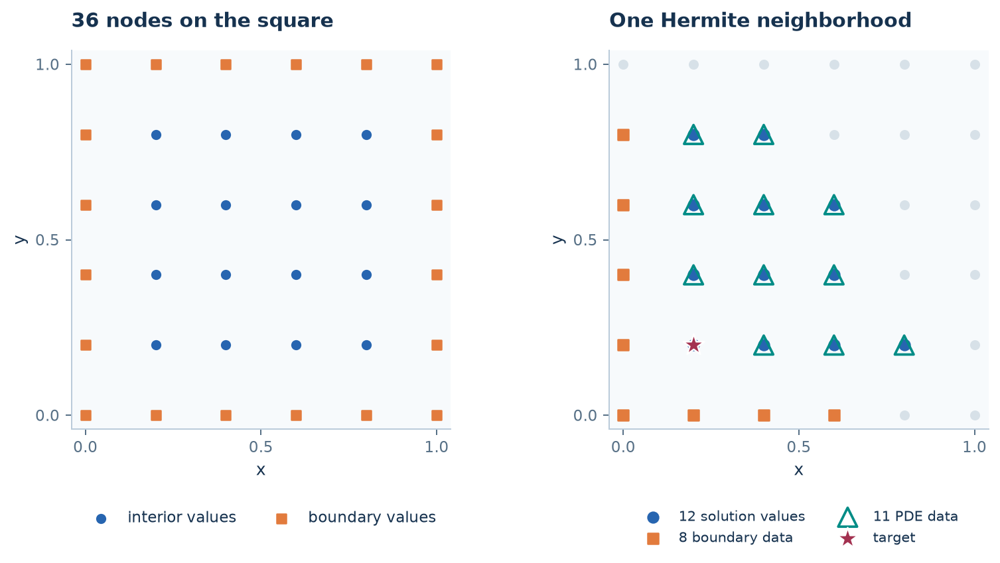

# Solve a PDE with global collocation

**Goal:** follow a global trial expansion through PDE rows, boundary rows,
coefficients, and evaluation. Read [interpolation](interpolation.md) first.

## 1. State the equation and choose centers

On the unit square, solve

$$-\Delta u=2\pi^2\sin(\pi x)\sin(\pi y),\qquad u|_{\partial\Omega}=0.$$

```python
import numpy as np
import sympy as sp
import rbflab as rbf
```

```python
--8<-- "examples/tutorials/global_collocation.py:problem"
```

`unit_box_grid(5)` divides each axis into five intervals: six points per axis,
36 total. Sixteen are interior. This small cloud makes a dense matrix easy to
inspect; no element connectivity is used.



The left panel is the global cloud used here. The right anticipates the
[LHI lesson](lhi.md), which reuses the same PDE and nodes.

## 2. Choose an ordinary radial trial expansion

For asymmetric collocation, use

$$s(x)=\sum_{j=1}^N a_jK(x,x_j),\qquad
A_{ij}=\begin{cases}-\Delta_xK(x_i,x_j),&x_i\in\Omega,\\
K(x_i,x_j),&x_i\in\partial\Omega.\end{cases}$$

Every row imposes the requested equation on the trial function. Solve $Aa=b$,
where $b_i=f(x_i)$ in the interior and $b_i=g(x_i)$ on the boundary.

```python
--8<-- "examples/tutorials/global_collocation.py:asymmetric"
```

`system.matrix` and `system.rhs` are the dense collocation system.
`solution.coefficients` contains $a$, not $u(X)$. `solution.evaluate(query)`
forms the kernel expansion at the query locations.
The method has no local stencil-size parameter: all 36 centers contribute.

## 3. Connect the matrix to kernel evaluations

We can build those same rows explicitly:

```python
--8<-- "examples/tutorials/global_collocation.py:rows"
```

`left=-Laplacian()` applies the PDE to the evaluation argument. Omitting it gives
value rows for Dirichlet data. This unaugmented asymmetric example stores rows
and columns in `cloud.points` order, so `A` matches `system.matrix` directly.
`direct_values` shows exactly how coefficients become field values.

## 4. Change the trial space: symmetric collocation

Let $\lambda_i$ be the PDE or boundary functional at the $i$th functional center.
The symmetric construction uses

$$s(x)=\sum_j a_j\lambda_j^yK(x,y),\qquad
G_{ij}=\lambda_i^x\lambda_j^yK(x,y).$$

```python
--8<-- "examples/tutorials/global_collocation.py:symmetric"
```

The same problem is imposed, but the trial functions and coefficients change.
Use `hermite_solution.evaluate` to apply that expansion; multiplying its
coefficients by an ordinary kernel-value matrix would evaluate the wrong basis.
The unaugmented symmetric implementation orders interior functional centers
before boundary functional centers; `hermite_system.centers` and `.operators`
record that ordering. Do not assume array layouts from a different scheme.

## Modify the construction

- Change the symbolic equation or boundary data to change the imposed rows.
- Change `kernel` to change the trial functions.
- Add `polynomial_degree=...` when polynomial augmentation is desired or required;
  the resulting system also includes polynomial coefficients and side conditions.
- Use `solution.evaluate(query, rbf.Derivative(0))` for a derivative of the solution.

Global collocation uses dense storage. For local constructions, continue with
[RBF-FD](one-stencil.md) or [LHI](lhi.md). These are not just different dense solvers.

### A quick check

The script verifies that the explicitly constructed asymmetric matrix and
expansion agree with their assembled counterparts, then evaluates both methods.
This teaches matrix meaning rather than ranking the two recipes.

## Native double and multiprecision

After the [optional C++ setup](../INSTALL.md#4-enable-c-on-ubuntu-linux), select
`CppGlobalBackend` on the same scalar stationary method:

```python
native = rbf.GlobalCollocation(
    rbf.PHS(5),
    scheme="symmetric",              # or "asymmetric"
    polynomial_degree=2,
    backend=rbf.CppGlobalBackend(threads=4, compute_condition=False),
    precision=rbf.Precision(global_digits=80),
)
system = native.assemble(problem, cloud)
solution = system.solve()
values = solution.evaluate(cloud.points)        # NumPy Float64 output
values_mp = solution.evaluate_mp(cloud.points)  # extended-precision output
```

Use `Precision()` instead for native double. Extended precision data callbacks
must supply the `PrecisionData` interface; symbolic `model.data(...)` and the
symbolic equation frontend provide it. Increasing arithmetic precision cannot
recover digits already lost in a Float64 callback or input geometry.

The native worker assembles kernel and polynomial blocks, equilibrates and
factors the dense system, and evaluates the expansion. It keeps its factorization
for subsequent solves. Both schemes and optional polynomial augmentation work
in 2D and 3D. A first call can include kernel compilation; cached calls reuse the
compiled executable.

Use a context manager when solving many independent systems, so that the worker
is released deterministically after evaluation:

```python
with native.assemble(problem, cloud) as system:
    solution = system.solve()
    values_mp = solution.evaluate_mp(cloud.points)
```

Solutions need their system's worker for later evaluation, so evaluate before
leaving the context or calling `system.close()`.

`system.matrix` is a native matrix proxy. Inspect or edit an entry with
`system.matrix[i, j]`; an edit invalidates the LU factorization. Use
`system.matrix.to_numpy()` for an explicit Float64 copy or
`system.matrix.to_mpmath()` for an extended-precision copy in MPFR mode. Editing
an exported copy does not change the native system until it is assigned back
to `system.matrix`. Updating `system.rhs` reuses the unchanged matrix factors.

The default `derivative_order=2` on `CppGlobalBackend` prepares value, gradient
and second-derivative evaluation in addition to assembly's required derivatives.
Set a higher order before assembly when the kernel supports the derivatives you
need. `compute_condition=True` requests a 1-norm condition estimate for the
equilibrated matrix; it is not the Python Float64 solver's 2-norm condition.

Run a small polynomial reproduction check with:

```sh
python -m examples.global_cpp
python -m examples.global_cpp --scheme asymmetric --digits 60 --dimension 3
```

This example checks the algebra using an exactly representable quadratic field;
it is not a general PDE convergence or performance benchmark.

The backend currently covers scalar stationary problems. Coupled scalar systems,
divergence-free Stokes and time-dependent problems use their existing Python
paths and cannot select `CppGlobalBackend`.

Dense storage remains quadratic in the number of coefficients, and dense LU
factorization remains cubic. MPFR improves arithmetic precision; it does not
remove an ill-posed PDE or guarantee a well-conditioned trial space.

## Complete example

Run `python -m examples.tutorials.global_collocation` from a [source checkout](../INSTALL.md).
The short API fragments above also work with an installed package when combined
with their imports and preceding steps.

??? example "Complete runnable script"

    ```python
    --8<-- "examples/tutorials/global_collocation.py"
    ```

[Download the script](https://raw.githubusercontent.com/LDBreton/RBFLAB/main/examples/tutorials/global_collocation.py).
